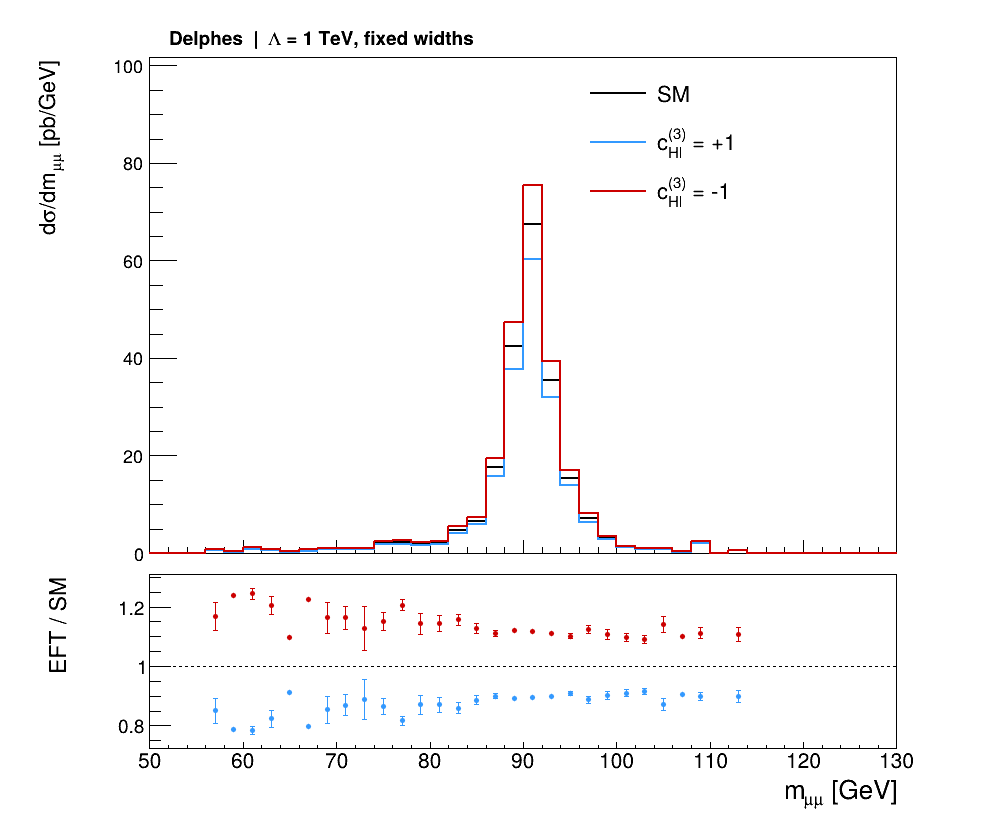

# From a SMEFTsim UFO to detector-level plots

English | [简体中文](README.zh-CN.md)

Follow one dimuon process through **UFO → MadGraph → Pythia → Delphes / Parnassus → ROOT plots**. The main exercise uses the same 13 TeV proton-collision sample throughout, retaining event identities and SMEFT weights from the hard process to reconstructed objects.

Start with [installation](docs/setup/README.md), then follow the [complete tutorial](docs/handbook.md). Both the dimuon workflow and the advanced Higgs exercise use one project-local **Python 3.12.12** environment.

| Entry point | What you will do |
|---|---|
| [Installation and activation](docs/setup/README.md) | Prepare Linux, pinned software and the shared environment |
| [Complete dimuon tutorial](docs/handbook.md) | Import the UFO, generate and reweight events, shower, simulate detectors and plot |
| [Advanced Higgs exercise](docs/higgs.md) | Study a four-body decay, interference, squared and propagator terms |
| [Topic notes](docs/README.md) | Consult models, Wilson coefficients, orders, parameters and Linux basics |
| [Example results](examples/dimuon/README.md) | Inspect 1,000 events, four processing stages and three plots |
| [Validation record](docs/validation.md) | Review versions, checks and measured results |



All three curves use the same events with the SM, `cHl3=+1` and `cHl3=-1` weights. The vertical axis retains cross-section normalization; the lower panel shows EFT/SM.

After installation, enter these commands in a Linux terminal:

```bash
cd ~/smeftsim
source scripts/env.sh
```

Continue with [section 2 of the tutorial](docs/handbook.md#2-import-the-ufo-and-export-the-dimuon-process). Windows readers first open their WSL terminal.

`config` contains readable settings; `scripts` supplies conversion, analysis and installation helpers. The handbook explains the package calls and the input/output of each step. `tools`, `.venv-unified`, `work` and `out` are local installation or runtime directories. Small reference figures and numerical records live in `examples`.

The SMEFTsim model and original Higgs tutorial come from Ilaria Brivio and collaborators. This workflow uses MadGraph for hard events, Pythia for showering, Delphes and Parnassus for detector response, and ROOT for plots. Versions, sources and attribution are recorded in [third-party notices](THIRD_PARTY_NOTICES.md).

## Sources and acknowledgments

| Resource | Authors or maintainers; role |
|---|---|
| [SMEFTsim](https://github.com/SMEFTsim/SMEFTsim) | Ilaria Brivio, Yun Jiang, Michael Trott and contributors; UFO model and theory |
| [June 2023 Higgs tutorial](https://github.com/IlariaBrivio/SMEFTsim_tutorial_June23) | Ilaria Brivio; original Higgs cards, restrictions and analysis/plotting scripts |
| [MadGraph5_aMC@NLO](https://github.com/mg5amcnlo/mg5amcnlo) | MadTeam; matrix elements, event generation and reweighting |
| [Pythia](https://pythia.org/) | Pythia collaboration; shower, hadronisation and decays |
| [Delphes](https://github.com/delphes/delphes) | Delphes collaboration; fast detector simulation |
| [Parnassus](https://github.com/parnassus-hep/parnassus) | Parnassus contributors; alternative detector-response workflow |
| [ROOT](https://root.cern/) | ROOT team; histograms and figures |
| [SMEFTsim 3.0 practical guide](https://arxiv.org/abs/2012.11343) | Ilaria Brivio; model implementation and conventions |

Detector interface sources are collected in [the source notes](docs/detector-sources.md). For scientific use, cite the original software and physics references relevant to your calculation.
