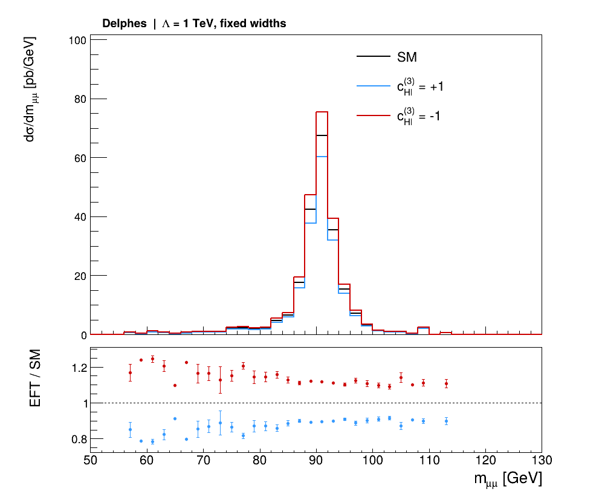

# 从 SMEFTsim UFO 到探测器图像

[English](README.md) | 简体中文

用一个双 muon 过程，亲手走完 **UFO → MadGraph → Pythia → Delphes / Parnassus → ROOT 图像**。主线使用同一批 13 TeV 质子碰撞事件；从硬散射到重建对象都能追溯到原事件和 SMEFT 权重。

第一次使用，先完成 [安装](docs/setup/README.zh-CN.md)，再打开 [完整教程](docs/handbook.zh-CN.md)。软件统一使用项目内的 **Python 3.12.12**；双 muon 主线和 Higgs 进阶案例共用这个环境。

| 入口 | 你会完成什么 |
|---|---|
| [安装与启动](docs/setup/README.zh-CN.md) | 准备 Linux、固定版本软件和统一环境 |
| [双 muon 完整教程](docs/handbook.zh-CN.md) | 导入 UFO、生成事件、重加权、shower、探测器模拟、画图 |
| [Higgs 进阶案例](docs/higgs.zh-CN.md) | 学习四体衰变、线性/平方/传播子贡献及 ROOT 分析 |
| [知识附录](docs/README.zh-CN.md) | 查模型、Wilson 系数、阶数、参数与 Linux 操作 |
| [实际运行结果](examples/dimuon/README.zh-CN.md) | 1,000 个事件、四阶段计数和三组图 |
| [验证记录](docs/validation.zh-CN.md) | 版本、检查内容与实际数值 |



图中三条曲线来自同一批事件。SM、`cHl3=+1` 与 `cHl3=-1` 使用各自的事件权重，纵轴保留截面归一化；下方显示 EFT/SM。

安装完成后，在 Linux 终端输入：

```bash
cd ~/smeftsim
source scripts/env.sh
```

然后从 [教程第 2 节](docs/handbook.zh-CN.md#2-导入-ufo生成双-muon-过程) 开始。Windows 用户先打开 WSL 终端，再输入这些命令。

仓库中的 `config` 保存可读的配置，`scripts` 负责文件转换、分析和安装准备；手册会解释它们调用的软件和每一步的输入输出。`tools`、`.venv-unified`、`work`、`out` 是安装或运行产生的本地目录。小型参考图和数值保存在 `examples`。

SMEFTsim 模型及 Higgs 原教程来自 Ilaria Brivio 等作者，事件生成使用 MadGraph，shower 使用 Pythia，探测器模拟使用 Delphes 与 Parnassus，绘图使用 ROOT。版本、来源与署名见 [第三方说明](THIRD_PARTY_NOTICES.zh-CN.md)。

## 来源与致谢

| 资料 | 作者或维护者及用途 |
|---|---|
| [SMEFTsim](https://github.com/SMEFTsim/SMEFTsim) | Ilaria Brivio、Yun Jiang、Michael Trott 等；UFO 模型与理论 |
| [June 2023 Higgs 教程](https://github.com/IlariaBrivio/SMEFTsim_tutorial_June23) | Ilaria Brivio；原 Higgs 卡、restriction、分析与绘图脚本 |
| [MadGraph5_aMC@NLO](https://github.com/mg5amcnlo/mg5amcnlo) | MadTeam；矩阵元、事件生成与重加权 |
| [Pythia](https://pythia.org/) | Pythia collaboration；shower、强子化与衰变 |
| [Delphes](https://github.com/delphes/delphes) | Delphes collaboration；快速探测器模拟 |
| [Parnassus](https://github.com/parnassus-hep/parnassus) | Parnassus contributors；另一条探测器响应流程 |
| [ROOT](https://root.cern/) | ROOT 团队；直方图与图像 |
| [SMEFTsim 3.0 practical guide](https://arxiv.org/abs/2012.11343) | Ilaria Brivio；模型实现与约定 |

探测器接口的出处汇总在 [来源记录](docs/detector-sources.zh-CN.md)。用于研究时，按实际使用的软件和物理内容引用原始文献。
