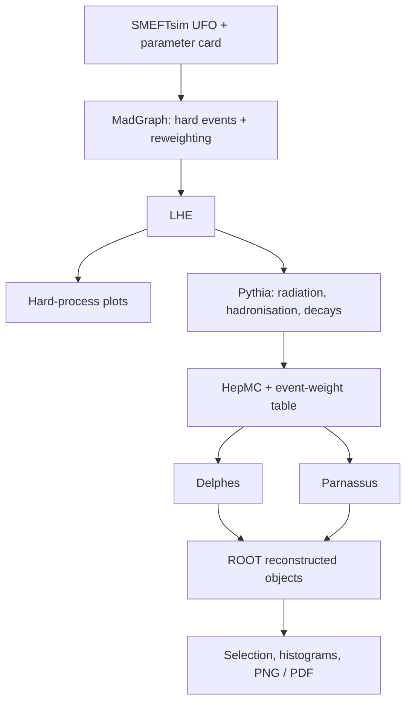

# Dimuons: from the UFO to final plots

[简体中文](handbook.zh-CN.md) | [Project home](../README.md) | [Advanced Higgs exercise](higgs.md)

We simulate $pp\to\mu^+\mu^-$ at 13 TeV, including $Z/\gamma^*$ and SMEFT interactions. We first generate an SM sample, then calculate `cHl3=+1/-1` weights for the same events. The final plots show the hard process, stable particles, reconstructed muons and detector-level SM/EFT comparisons.

## 1. Activate the environment and follow the files

Complete [installation](setup/README.md), then open **Linux Bash**. Enter each command, press Enter and wait for the prompt to return:

```bash
cd ~/smeftsim
source scripts/env.sh
python --version
```

The version should be Python 3.12.12. All subsequent Bash commands run from this project root unless an explicit `cd` changes directory.



| File | Contents |
|---|---|
| `work/dy/Cards/*.dat` | Numerical settings for the exported process |
| `out/dy/hard.lhe` | Hard four-momenta, cross section and parameter-point weights |
| `out/dy/showered.hepmc` | Showered particles, vertices, event IDs and named weights |
| `out/dy/weights.json` | The same events' weights and input-file fingerprints |
| `out/dy/delphes.root` | Delphes reconstructed objects |
| `out/dy/parnassus.root` | Parnassus reconstructed objects |
| `out/dy/plots` | Final figures, histograms and counts |

## 2. Import the UFO and export the dimuon process

A UFO is a model directory. Its Python files define particles, parameters, interactions and coupling orders. Installation prepares it in `work/Material`.

In **Bash**, enter:

```bash
python tools/mg/bin/mg5_aMC
```

At the **`MG5_aMC>`** prompt, enter:

```text
set auto_update 0 --no_save
set auto_convert_model True --no_save
import model ./work/Material/SMEFTsim_U35_MwScheme_UFO-massless
define p = g u c d s u~ c~ d~ s~
generate p p > mu+ mu- SMHLOOP=0 NP=1 NPprop=0
display processes
output work/dy
quit
```

The `massless` restriction sets the relevant light-fermion masses to zero while retaining the EFT vertices we will need later. `p` defines the incoming partons included in this exercise. `NP=1` permits at most one dimension-six insertion in the amplitude; `SMHLOOP=0` and `NPprop=0` switch off the effective Higgs-loop vertices and dummy propagator corrections that this exercise does not use.

This exports computational code; it does not yet generate events. We next set the numerical Wilson coefficients to zero for the SM baseline, keeping the EFT vertices available for reweighting. See the [model notes](model/README.md) for flavor and input-scheme background.

The same commands are saved in [config/dy_process.mg5](../config/dy_process.mg5). For a first export, you may instead run:

```bash
python tools/mg/bin/mg5_aMC config/dy_process.mg5
```

Choose either interactive entry or the command file. If `work/dy` already exists, continue below; use a new directory name when exporting a different process.

## 3. Set numerical values, generate and reweight

In **Bash**:

```bash
python scripts/prepare_dy.py --events 1000 --seed 12345
```

The helper sets the exported Wilson coefficients to zero and applies the run settings below. To inspect the parameter card, optionally open it with `nano work/dy/Cards/param_card.dat` and press `Ctrl+X` to return to Bash.

| Setting | Value | Purpose |
|---|---:|---|
| `LambdaSMEFT` | 1000 GeV | EFT scale |
| Wilson coefficients | All zero | SM baseline sample |
| `nevents` / `iseed` | 1000 / 12345 | Event count and hard-process seed |
| `ebeam1` / `ebeam2` | 6500 / 6500 GeV | Proton beam energies |
| `ptl` / `ptlmax` | 10 / -1 GeV | Lepton pT minimum; -1 means no upper cut |
| `etal` | 2.5 | Generator-level maximum absolute pseudorapidity |
| `mmll` / `mmllmax` | 60 / 120 GeV | Generator-level dimuon mass window |
| `pdlabel` | `nn23lo1` | Built-in MadGraph PDF |

`param_card.dat` contains model values, `run_card.dat` controls sampling and cuts, and `reweight_card.dat` defines three points:

| Label | Meaning |
|---|---|
| `sm_check` | Keep all coefficients zero to check recovery of the SM weights |
| `cHl3_plus` | Change only `cHl3` to +1 |
| `cHl3_minus` | Change only `cHl3` to -1 |

Read the full [reweight card](../config/dy_reweight.dat). These are **complete target points for the selected amplitude**, including its squared contribution; masses and widths stay at their baseline values. The advanced Higgs exercise separately extracts interference terms instead.

Generate the sample:

```bash
work/dy/bin/generate_events dy_1000 -f --nb_core=4
```

`dy_1000` names the run; the card specifies the number of events. `-f` uses the current cards and skips editing menus; `--nb_core=4` uses four CPU cores. With the prepared reweight card present, this generates SM events and calculates all three additional weights. Wait for the Bash prompt to return.

Uncompress the result into the workflow's data directory:

```bash
mkdir -p out/dy
gzip -dc work/dy/Events/dy_1000/unweighted_events.lhe.gz > out/dy/hard.lhe
```

The original compressed file and banner remain in the run directory. The banner captures the model, cards and integration result actually used, so it is useful when working cards have subsequently changed.

## 4. Plot the hard process first

```bash
python scripts/plot_dy.py --lhe-only --out out/dy/hard_plots
```

This reads the LHE, checks its events and weights, and uses ROOT to plot dimuon mass, muon pT and the EFT comparison. No shower or detector response has been applied yet.

`out/dy/hard_plots/summary.json` should report 1,000 events and four labels: nominal SM plus the three reweights. `sm_check` reproduces the nominal weights. The reference run has a baseline cross section of approximately **627.722 pb**.

## 5. Pythia: hard events to stable particles

Read [config/shower.cmnd](../config/shower.cmnd):

| Setting | Effect |
|---|---|
| `Beams:frameType = 4` | Read external LHE hard events |
| `Beams:LHEF` | Select the LHE path |
| `Random:seed = 24680` | Set an independent shower seed |
| `ParticleDecays:tau0Max = 10` | With the lifetime limit enabled, leave longer-lived particles stable |

ISR, FSR, MPI, hadronisation and decays remain enabled; there is no pileup. MPI describes multiple parton interactions in one collision, while pileup adds other collisions.

```bash
python scripts/shower.py
```

[shower.py](../scripts/shower.py) loops over the actual LHE event count. Its main package calls are:

| Call | Action |
|---|---|
| `pythia8mc.Pythia()` | Create the generator |
| `readFile(...)` / `readString(...)` | Read settings and select this LHE |
| `init()` | Initialize the beams and simulation |
| `next()` | Process the next hard event |
| `to_hepmc(...)` / `writer.write(...)` | Serialize particles and weights |

The helper checks Pythia's input weights, the converted stable particles, and the IDs and weights read back from disk. Completion reports **1,000 events and 4 named weights**. `weights.json` stores the same weights; analysis joins them to reconstructed objects using event IDs.

The hard-process weights change between parameter points, while the SM shower and detector response are shared. The plots therefore describe hard-process parameter changes with this fixed downstream simulation.

## 6. Delphes: particles to reconstructed objects

Installation copies the CMS card from the pinned Delphes version and sets seed 31415. Read `config/delphes_CMS.tcl` and follow `ExecutionPath` through propagation, efficiencies, momentum resolution, isolation and output.

```bash
tools/delphes/DelphesHepMC3 config/delphes_CMS.tcl out/dy/delphes.root out/dy/showered.hepmc
```

The positional arguments are **card, output ROOT, input HepMC**. The output tree is `Delphes`; `Muon` contains reconstructed, isolated muons, and `Particle` contains generator particles.

Delphes requires a new output file. To repeat this step, give it a new filename and pass that path to `plot_dy.py --delphes`, or move the previous output before repeating the command.

Reconstructed collections can contain fewer objects and shifted momenta. The tree still has 1,000 rows, one per event, including events with no selected muons.

## 7. Make the final plots

```bash
python scripts/plot_dy.py
```

| Figure | Comparison |
|---|---|
| `dimuon_mass.png` / `.pdf` | Dimuon mass at hard, stable-particle and Delphes levels |
| `muon_pt.png` / `.pdf` | Selected muon transverse momentum at each stage |
| `eft_dimuon_mass.png` / `.pdf` | Delphes-level SM and `cHl3=+1/-1`, plus EFT/SM |

Figures are in `out/dy/plots`. `histograms.root` stores the numerical histograms; `summary.json` records event counts, muon counts, selected dimuon events and cross sections.

The analysis requires $p_T>10$ GeV and $|\eta|<2.4$, then uses the two highest-pT muons for the pair mass. Stable particles use these same kinematic cuts; Delphes muons have additionally passed the card's reconstruction and isolation.

The vertical axis is **pb/GeV**. For a bin of width $\Delta x$, we calculate

$$\frac{1}{N\Delta x}\sum_{i\,\mathrm{in\ bin}}w_i,$$

where $N$ is the total generated event count and $w_i$ is the corresponding normalized LHE weight. Each selected muon contributes to the pT distribution; each selected event contributes once to dimuon mass. This preserves both shape and acceptance changes.

EFT/SM ratio uncertainties include the correlation between the two weights of the same event. Do not multiply a target weight by the nominal SM weight again.

In WSL, use `explorer.exe "$(wslpath -w "$PWD/out/dy/plots")"` to open the folder. On a Linux desktop, use your file manager.

## 8. Add the Parnassus comparison

Parnassus starts from **the same HepMC file**. This exercise uses its CPU parametric CMS response:

```bash
OMP_NUM_THREADS=4 MKL_NUM_THREADS=4 parnassus run -c config/parnassus.yaml -i out/dy/showered.hepmc -ne 1000 -bs 10 -o out/dy/parnassus.root --random_seed 31415
python scripts/plot_dy.py --parnassus out/dy/parnassus.root
```

`-ne` is the event count and `-bs` is the batch size. `MuonIsolation` computes an isolation variable, and analysis then requires `Muons.IsolationVar<0.25`. This refreshes `out/dy/plots` and adds a Parnassus curve to the first two figures. The EFT/SM figure uses the Delphes response. Both backends' event IDs are matched to the original LHE.

The two CMS responses implement their own efficiencies and resolutions, so their distributions and selected counts differ. See the [example results](../examples/dimuon/README.md).

## 9. Keep a run and continue learning

Keep the generator run and banner, all cards, LHE, HepMC, weight table, detector ROOT files and plotting directory together. JSON records contain file hashes and counts to identify the sample used.

Use a new run name and output directory for a new exercise. `shower.py` accepts `--lhe`, `--card`, `--out` and `--weights`; `plot_dy.py` has corresponding input options. Rerunning analysis refreshes the figures in its selected output directory.

Start by reading the selection fractions at each stage, increasing statistics, or changing one `cHl3` value in the reweight card and explaining the resulting rate and shape. Then follow the [Higgs exercise](higgs.md) to extract interference, squared and propagator contributions separately.
