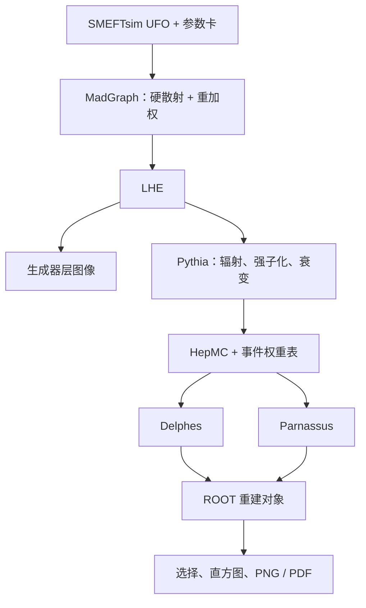

# 双 muon：从 UFO 到最终图像

[English](handbook.md) | [项目首页](../README.zh-CN.md) | [Higgs 进阶](higgs.zh-CN.md)

本教程在 13 TeV 下模拟 $pp\to\mu^+\mu^-$，包括 $Z/\gamma^*$ 及 SMEFT 相互作用。先生成 SM 事件，再为同一事件计算 `cHl3=+1/-1` 的权重。最终你会得到硬散射、稳定粒子、重建 muon 的分布，以及探测器层的 SM/EFT 对比图。

## 1. 进入环境，认识整条链

先完成 [安装](setup/README.zh-CN.md)。打开 **Linux Bash**，逐行输入，按 Enter，等提示符回来再输入下一行：

```bash
cd ~/smeftsim
source scripts/env.sh
python --version
```

应显示 Python 3.12.12。后面的 Bash 命令都从这个项目根目录执行；遇到明确的 `cd` 再切换。



| 文件 | 它保存什么 |
|---|---|
| `work/dy/Cards/*.dat` | 过程导出后使用的数值设置 |
| `out/dy/hard.lhe` | 硬散射四动量、截面和各参数点权重 |
| `out/dy/showered.hepmc` | shower 后粒子、顶点、事件编号和命名权重 |
| `out/dy/weights.json` | 同一批事件的权重表与输入文件指纹 |
| `out/dy/delphes.root` | Delphes 重建对象 |
| `out/dy/parnassus.root` | Parnassus 重建对象 |
| `out/dy/plots` | 最终图片、直方图与计数 |

## 2. 导入 UFO，生成双 muon 过程

UFO 是一个模型目录，里面的 Python 文件定义粒子、参数、相互作用和耦合阶数。安装步骤已把它准备到 `work/Material`。

在 **Bash** 输入：

```bash
python tools/mg/bin/mg5_aMC
```

看到 **`MG5_aMC>`** 后逐行输入：

```text
set auto_update 0 --no_save
set auto_convert_model True --no_save
import model ./work/Material/SMEFTsim_U35_MwScheme_UFO-massless
define p = g u c d s u~ c~ d~ s~
generate p p > mu+ mu- SMHLOOP=0 NP=1 NPprop=0
display processes
output work/dy
quit
```

`massless` 在导入模型时把本练习的轻费米子质量设为零，同时保留后续需要的 EFT 顶点。`p` 定义这里包含的初态 parton。`NP=1` 表示振幅中至多一个维六插入；`SMHLOOP=0` 和 `NPprop=0` 关闭这次不用的有效 Higgs loop 顶点与 dummy propagator 修正。

此时只是导出了计算程序，还没有事件。接下来将数值 Wilson 系数全设为零，得到 SM 基线；保留的 EFT 顶点供重加权使用。模型的 flavor 和输入 scheme 说明见 [模型附录](model/README.zh-CN.md)。

上面相同的命令也保存在 [config/dy_process.mg5](../config/dy_process.mg5)。首次导出时可直接调用：

```bash
python tools/mg/bin/mg5_aMC config/dy_process.mg5
```

交互输入和命令文件任选一种。`work/dy` 已存在时从下一节继续；想导出另一个过程时换一个目录名。

## 3. 设置数值，生成和重加权

在 **Bash** 输入：

```bash
python scripts/prepare_dy.py --events 1000 --seed 12345
nano work/dy/Cards/param_card.dat
```

准备脚本把导出卡里的 Wilson 系数设为零，并写入下面的运行设置。打开卡后可以直接查看；`Ctrl+X` 返回终端。用 `nano` 修改文件时，`Ctrl+O`、Enter 保存，再 `Ctrl+X` 退出。

| 设置 | 本例数值 | 作用 |
|---|---:|---|
| `LambdaSMEFT` | 1000 GeV | EFT 能标 |
| Wilson 系数 | 全部为 0 | 基础样本是 SM |
| `nevents` / `iseed` | 1000 / 12345 | 事件数与硬散射种子 |
| `ebeam1` / `ebeam2` | 6500 / 6500 GeV | 两束质子能量 |
| `ptl` / `ptlmax` | 10 / -1 GeV | 轻子 pT 下限；-1 表示无上限 |
| `etal` | 2.5 | 生成层的最大绝对赝快度 |
| `mmll` / `mmllmax` | 60 / 120 GeV | 生成层双 muon 质量窗口 |
| `pdlabel` | `nn23lo1` | MadGraph 内置 PDF |

`param_card.dat` 保存模型数值，`run_card.dat` 保存抽样和切选；`reweight_card.dat` 定义三个重加权点：

| 标签 | 含义 |
|---|---|
| `sm_check` | 系数仍为零，用来核对重加权是否回到 SM |
| `cHl3_plus` | 只把 `cHl3` 改为 +1 |
| `cHl3_minus` | 只把 `cHl3` 改为 -1 |

卡的完整内容见 [dy_reweight.dat](../config/dy_reweight.dat)。这里计算的是所选振幅下的**完整目标点**，包括振幅平方产生的平方项；质量和宽度保持基线值。它与 Higgs 进阶案例中单独提取线性贡献的做法不同。

开始生成：

```bash
work/dy/bin/generate_events dy_1000 -f --nb_core=4
```

`dy_1000` 是 run 名；事件数来自卡。`-f` 使用当前卡并跳过编辑菜单，`--nb_core=4` 使用四个 CPU 核心。因为已经准备了重加权卡，这一步会先生成 SM 样本，再计算三个权重。等程序结束并出现 Bash 提示符。

把这次结果解压到主线的数据目录：

```bash
mkdir -p out/dy
gzip -dc work/dy/Events/dy_1000/unweighted_events.lhe.gz > out/dy/hard.lhe
```

原始压缩文件和 banner 留在 run 目录。banner 记录实际使用的模型、卡和积分结果；它比事后修改的工作卡更适合查一次运行的设置。

## 4. 先画硬散射层的图

```bash
python scripts/plot_dy.py --lhe-only --out out/dy/hard_plots
```

脚本读取 LHE，检查事件和权重，再用 ROOT 生成双 muon 质量、muon pT 和 EFT 对比图。此时还没有 shower 或探测器响应。

查看 `out/dy/hard_plots/summary.json`，应有 1,000 个事件和四个标签（名义 SM 加三个重加权标签）。`sm_check` 应重现名义 SM 权重。参考运行的基线截面约为 **627.722 pb**。

## 5. Pythia：从硬事件到稳定粒子

先读 [config/shower.cmnd](../config/shower.cmnd)：

| 设置 | 作用 |
|---|---|
| `Beams:frameType = 4` | 从外部 LHE 读取硬事件 |
| `Beams:LHEF` | LHE 输入路径 |
| `Random:seed = 24680` | shower 的独立随机种子 |
| `ParticleDecays:tau0Max = 10` | 配合寿命限制，把较长寿命粒子留作稳定粒子 |

本例保留 ISR、FSR、MPI、强子化和衰变，不加 pileup。MPI 是同一次碰撞中的多重 parton 相互作用，pileup 是其他碰撞的叠加。

```bash
python scripts/shower.py
```

[shower.py](../scripts/shower.py) 按 LHE 的实际事件数循环，关键调用是：

| 调用 | 发生什么 |
|---|---|
| `pythia8mc.Pythia()` | 创建生成器 |
| `readFile(...)` / `readString(...)` | 读卡并指定本次 LHE |
| `init()` | 初始化束流和模拟 |
| `next()` | 处理下一个硬事件 |
| `to_hepmc(...)` / `writer.write(...)` | 把粒子和权重写入 HepMC |

脚本逐事件核对 Pythia 读到的权重、转换后的稳定粒子及写入磁盘的编号和权重。正常结束时会显示 **1,000 events and 4 named weights**。对应的 `weights.json` 保存同样的权重；后面的分析用事件编号把它们接回重建对象。

每组参数对应的硬散射权重不同，但这里共用一套 SM shower 和探测器响应。图描述的是这套固定后续模拟下的硬过程参数变化。

## 6. Delphes：从粒子到重建对象

安装时已从固定版本 Delphes 复制 CMS 卡，并设置种子 31415。打开 `config/delphes_CMS.tcl` 可以沿着 `ExecutionPath` 查看传播、效率、动量分辨率、隔离和输出模块。

```bash
tools/delphes/DelphesHepMC3 config/delphes_CMS.tcl out/dy/delphes.root out/dy/showered.hepmc
```

三个位置参数依次是：**卡、输出 ROOT、输入 HepMC**。输出树叫 `Delphes`；`Muon` 是完成重建和隔离选择后的 muon，`Particle` 保存生成器粒子记录。

这一步的重建对象可能少于输入稳定粒子，动量也会变化。树中仍有 1,000 行，每行对应一个事件；没有选中 muon 的事件也占一行。

## 7. 画出主线结果

```bash
python scripts/plot_dy.py
```

| 图片 | 你在比较什么 |
|---|---|
| `dimuon_mass.png` / `.pdf` | 硬散射、稳定粒子、Delphes 的双 muon 质量 |
| `muon_pt.png` / `.pdf` | 各阶段选中 muon 的横动量 |
| `eft_dimuon_mass.png` / `.pdf` | Delphes 层 SM 与 `cHl3=+1/-1`，以及 EFT/SM |

图片在 `out/dy/plots`。同目录的 `histograms.root` 保存数值，`summary.json` 保存各阶段事件数、muon 数、选中双 muon 事件数和截面。

分析要求 $p_T>10$ GeV、$|\eta|<2.4$；每个事件选 pT 最高的两条 muon 计算质量。稳定粒子层使用相同运动学切选；Delphes muon 还经过卡中的隔离与重建。

纵轴是 **pb/GeV**。对一个宽度为 $\Delta x$ 的 bin，计算

$$\frac{1}{N\Delta x}\sum_{i\,\mathrm{in\ bin}} w_i,$$

其中 $N$ 是生成的总事件数，$w_i$ 是 LHE 中已带归一化的对应权重。对 muon pT，每个选中 muon 都贡献一次；对双 muon 质量，每个选中事件贡献一次。这样图同时保留形状和接受率变化。

EFT/SM 比值的误差考虑同一事件上两种权重的相关性。换了参数点也不需要重复乘一次 SM 权重。

WSL 中可用 `explorer.exe out/dy/plots` 打开文件夹；Linux 桌面直接用文件管理器打开。

## 8. 加入 Parnassus 比较

Parnassus 从**同一份 HepMC** 出发。此例使用 CPU 参数化 CMS 响应：

```bash
OMP_NUM_THREADS=4 MKL_NUM_THREADS=4 parnassus run -c config/parnassus.yaml -i out/dy/showered.hepmc -ne 1000 -bs 10 -o out/dy/parnassus.root --random_seed 31415
python scripts/plot_dy.py --parnassus out/dy/parnassus.root
```

`-ne` 是事件数，`-bs` 是每批事件数。配置中的 `MuonIsolation` 计算隔离变量，分析时再要求 `Muons.IsolationVar<0.25`。图会增加 Parnassus 曲线；两个后端的事件编号都与原 LHE 核对。

两个 CMS 响应有各自的效率和分辨率实现，因此分布与通过选择的计数会不同。参考结果见 [示例](../examples/dimuon/README.zh-CN.md)。

## 9. 保存结果，继续练习

一次完整练习应保留：生成器 run 及 banner、三种卡、LHE、HepMC、权重表、两份探测器输出和绘图目录。SHA256 与计数保存在 JSON 记录里，方便辨认使用的是哪批事件。

做新练习时换 run 名和输出目录。`shower.py` 的 `--lhe`、`--card`、`--out`、`--weights`，以及 `plot_dy.py` 的对应参数，可以把每次练习放在独立目录。重新运行绘图命令会刷新该目录里的分析结果。

建议先尝试三件事：读出各阶段的选择比例；增加统计量观察图的变化；在重加权卡中只改一个 `cHl3` 数值，再解释截面和形状的变化。接着阅读 [Higgs 进阶案例](higgs.zh-CN.md)，学习如何单独提取线性、平方和传播子贡献。
