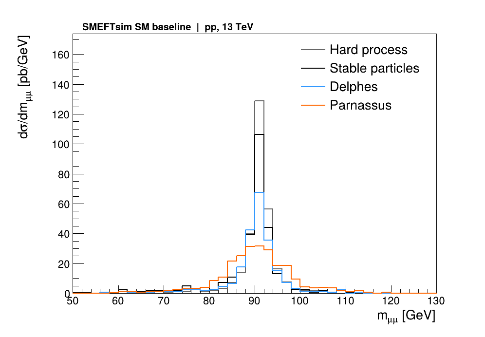
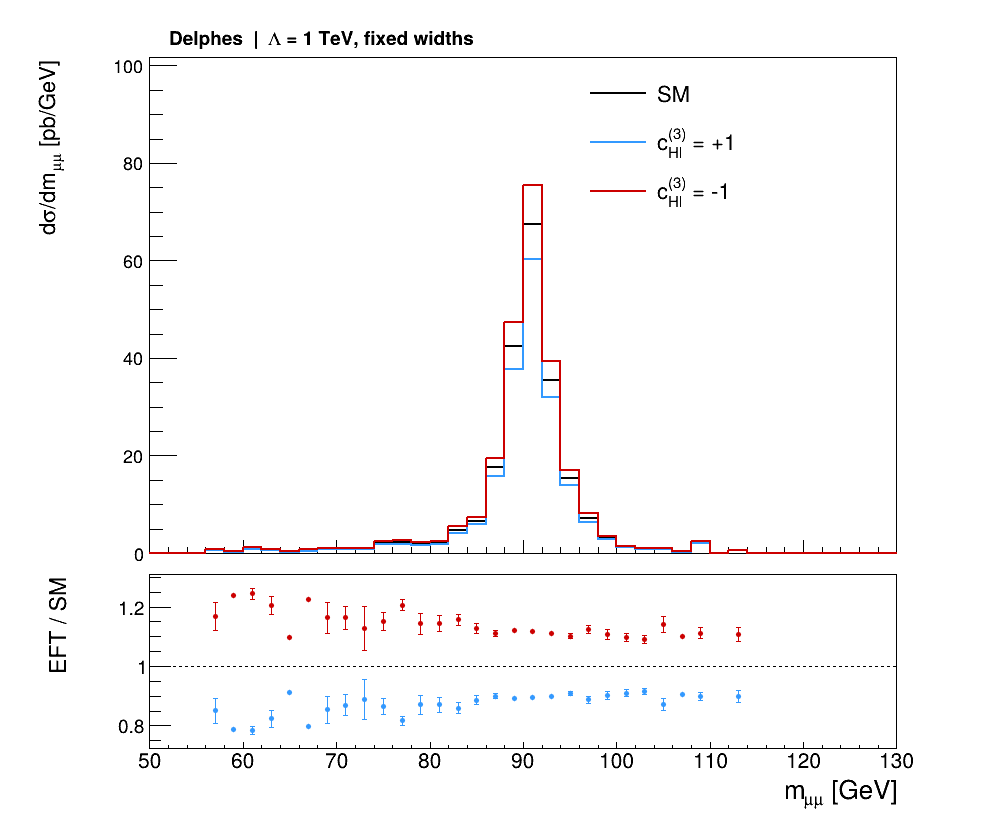
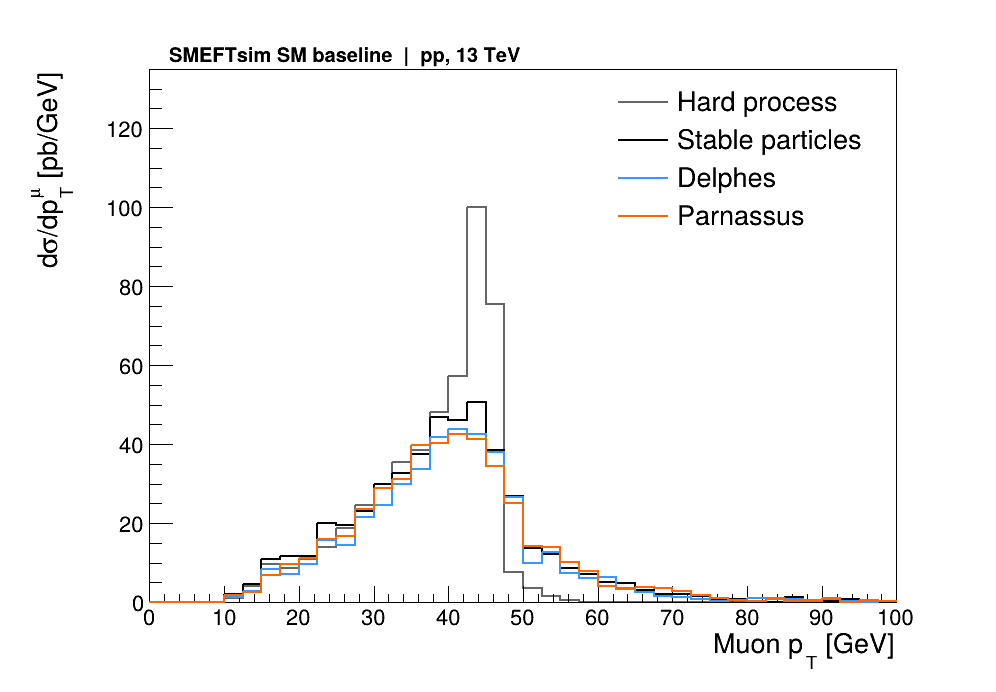

# Dimuons: results from the completed run

[简体中文](README.zh-CN.md) | [Complete tutorial](../../docs/handbook.md)

Run on 2026-11-09 in the shared Python 3.12 environment: SMEFTsim UFO → MadGraph → Pythia → Delphes / Parnassus → ROOT.

| Stage | Total events | Selected dimuon events |
|---|---:|---:|
| Hard process | 1000 | 948 |
| Stable particles after shower | 1000 | 906 |
| Delphes | 1000 | 704 |
| Parnassus | 1000 | 781 |

The total remains 1000 at every stage. The right column counts events containing a selected pair. Kinematic selection is pT > 10 GeV and |η| < 2.4, using each event's two highest-pT muons. Detector-level counts also include each response's reconstruction and isolation.

| Point | Generator cross section [pb] | Selected Delphes cross section [pb] |
|---|---:|---:|
| SM | 627.722 | 441.916 |
| `cHl3=+1` | 560.521 | 394.434 |
| `cHl3=-1` | 702.634 | 494.862 |

The SM integration error is 3.436 pb; EFT entries are reweighted estimates from the same events. The scale is 1 TeV, with fixed masses, widths and downstream simulation. `sm_check` equals the nominal SM weight in every event.

Each plot also has a PDF with the same name. `histograms.root` stores 32 histograms, `summary.json` stores raw counts, acceptance, cross sections and input hashes, and `validation.json` contains the full validation record.

The plots retain cross-section normalization in pb/GeV. Each selected muon contributes to pT, while each selected event contributes once to pair mass, so the two distribution integrals have different meanings.
