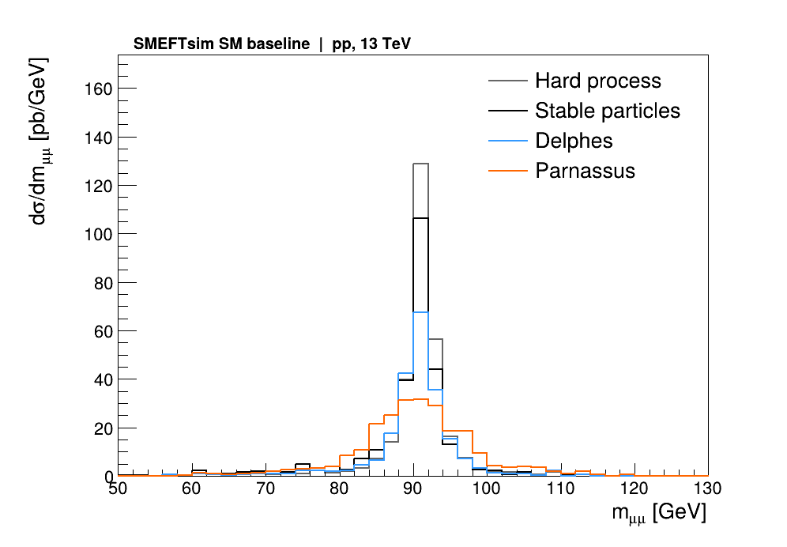
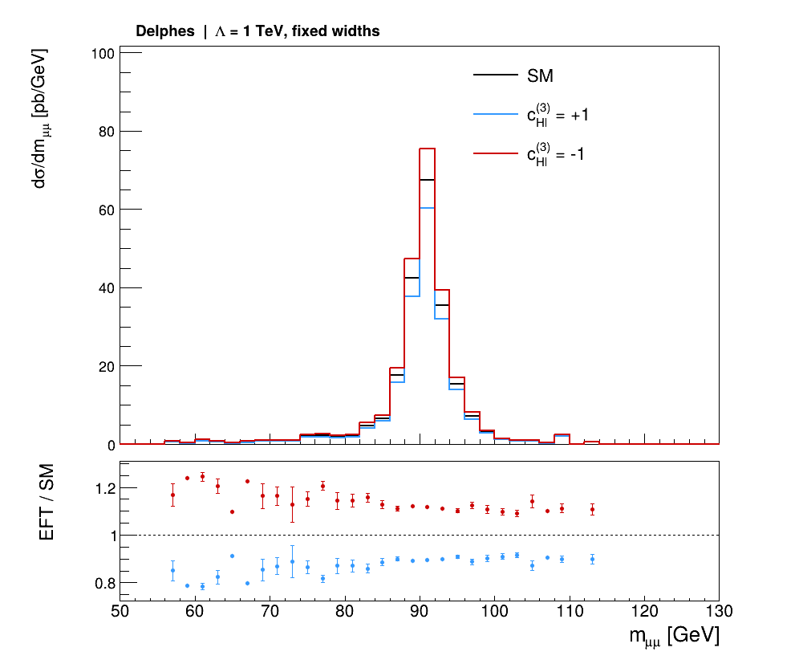
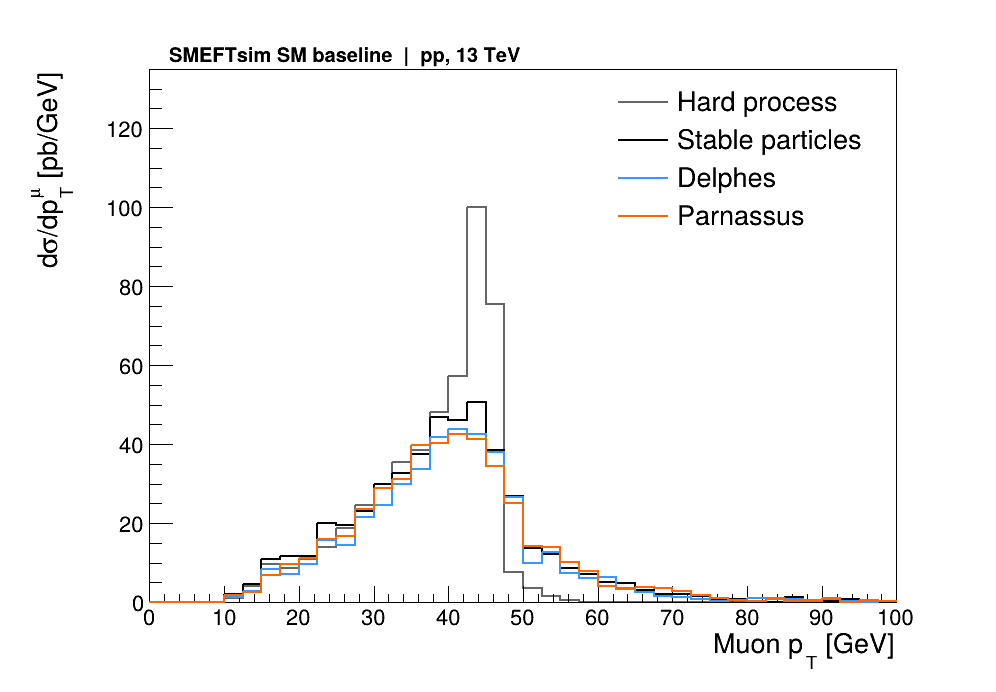

# 双 muon：实际运行结果

[English](README.md) | [完整教程](../../docs/handbook.zh-CN.md)

2026-11-09 在统一 Python 3.12 环境中运行：SMEFTsim UFO → MadGraph → Pythia → Delphes / Parnassus → ROOT。

| 阶段 | 总事件数 | 选中的双 muon 事件 |
|---|---:|---:|
| 硬散射 | 1000 | 948 |
| shower 后稳定粒子 | 1000 | 906 |
| Delphes | 1000 | 704 |
| Parnassus | 1000 | 781 |

总事件数始终为 1000；右列统计经过相应选择后还能组成双 muon 的事件。运动学选择为 pT > 10 GeV、|η| < 2.4，每个事件取 pT 最高的两条 muon。探测器层还包括各自的重建和隔离。

| 参数点 | 生成层截面 [pb] | Delphes 选中截面 [pb] |
|---|---:|---:|
| SM | 627.722 | 441.916 |
| `cHl3=+1` | 560.521 | 394.434 |
| `cHl3=-1` | 702.634 | 494.862 |

SM 基线的积分误差为 3.436 pb；表中 EFT 数值来自同批事件重加权。能标为 1 TeV，质量、宽度和后续模拟固定。`sm_check` 与名义 SM 权重逐事件一致。

每张图另有同名 PDF。`histograms.root` 保存 32 个直方图，`summary.json` 保存原始计数、选择比例、截面与输入指纹，`validation.json` 保存完整检查记录。

这些图使用截面归一化，纵轴为 pb/GeV。每条 muon 对 pT 图贡献一次，每个选中事件对质量图贡献一次；因此两类图的积分含义不同。
